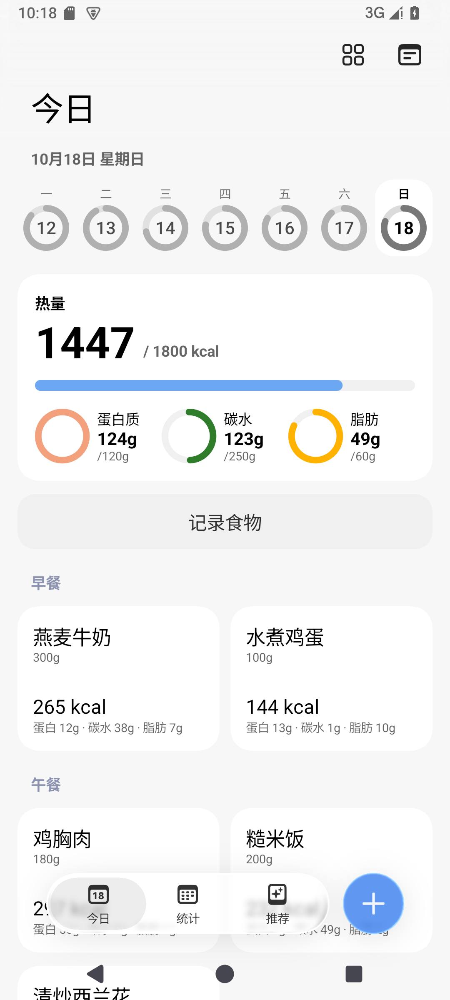
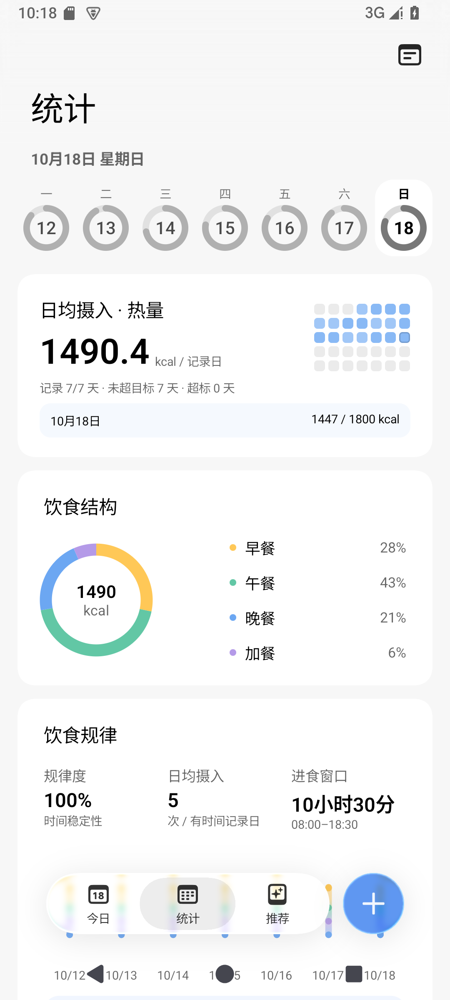
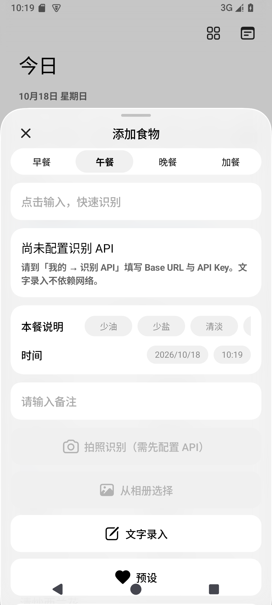
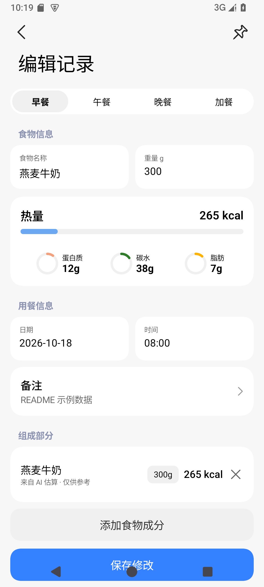
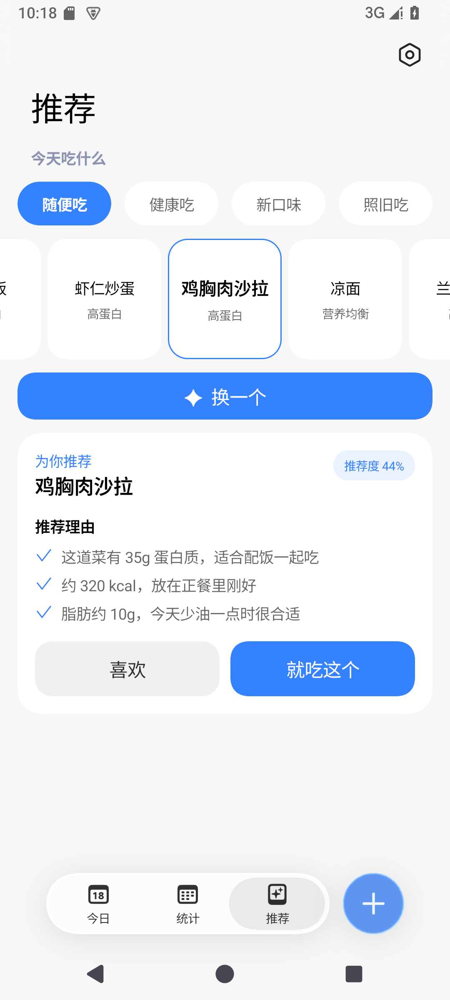
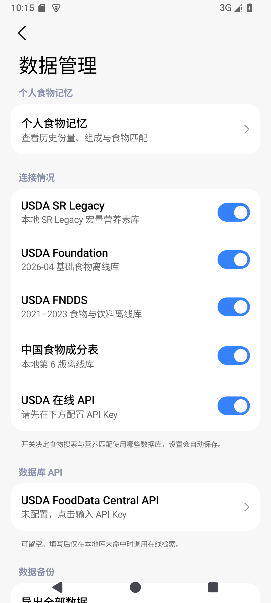

# LightMemo · 轻食记

拍照、描述或手动记录一餐，拆分食物组成、匹配营养数据库，追踪每日摄入与目标，也帮你决定下一餐吃什么。

[更新日志](docs/CHANGELOG.md) · [离线营养数据库](docs/nutrition-databases.md) · [MCP 连接说明](docs/mcp-service.md)

---

## 功能展示

以下截图来自当前 Debug 构建的 Android 模拟器，已开启玻璃特效与顶部渐变模糊；饮食记录为展示用示例数据。

### 今日与统计

- **摄入总览**：查看每日热量、蛋白质、碳水与脂肪，对照目标展示进度；支持周视图与月视图。
- **饮食记录管理**：按早餐、午餐、晚餐和加餐整理，支持编辑、调整份量、多选删除与“再记一次”。
- **统计与热力图**：查看日均摄入、达标天数、餐次占比、每日摄入趋势和用餐规律，点击热力图标题切换营养指标。
- **热量差**：连接 Health Connect 后查看摄入与消耗的差值；统计卡片可拖动排序、隐藏和恢复。
- **每日目标**：根据个人资料、活动水平和健身目标提供参考值，也可手动设置；修改时可从今天起生效或覆盖历史目标。

<p align="center">
  
  
</p>

### 记录一餐

- **多种录入方式**：支持拍照、相册、文字描述、手动填写与预设食物，记录时可补充餐次、时间、备注和饮食标签。
- **智能识别对话**：描述吃下的食物，由 AI 逐项确认份量；“记不清”时可按常见份量估算，生成结果后核对保存。
- **拆分与核对**：按菜品展示食物组成、重量区间、置信度与营养来源，支持更换成分、调整重量并即时重算；数据库未收录时可使用 AI 估算营养。
- **匹配确认**：结合中英文别名检索，检查食物种类、生熟与烹饪方式；有候选待选择或单个成分超过 800 kcal 时显示“需确认”。
- **个人食物记忆**：保存后学习份量、组成与数据库选择，下次识别可复用稳定的历史数据；支持查看和清除，同一照片在 48 小时内可选择复用上次结果。
- **后台识别进度**：离开应用后仍可继续处理，支持阶段进度、取消和重试；Android 16 实时更新通知的展示效果取决于设备系统支持。
- **MCP 服务**：设置 → AI 设置 → MCP 服务，连接小爱查询当天摄入与目标，或通过文字描述发起识别，核对后保存。详见 [连接说明](docs/mcp-service.md)。

<p align="center">
  
  
</p>

### 今天吃什么

- **四种推荐方式**：随便吃、健康吃、新口味、照旧吃，按当天营养目标、饮食习惯和偏好推荐菜品。
- **推荐搭配**：根据剩余营养提供搭配，优先考虑预设和常吃食物；支持喜欢、不喜欢、换一个与“就吃这个”，确认后记入今日饮食。
- **常用食物预设**：支持新建、编辑和删除，也可从已记录的食物加入预设，方便下次直接使用。

<p align="center">
  
</p>

### 数据管理与诊断

- **离线营养数据库**：内置 USDA SR Legacy、Foundation、FNDDS 与中国食物成分表，支持浏览、搜索和按数据源筛选；各数据库与可选在线 API 均可独立开关。
- **备份与导出**：支持完整备份和恢复；也可单独导出饮食记录与营养数据，便于交给 AI 分析。完整备份包含 API Key；食物数据导出不含配置、个人资料与照片。
- **本地诊断**：关于 → 诊断信息，查看最近 30 天的识别成功率、耗时、匹配及推荐统计，支持 JSON 导出和清空。
- **识别日志**：可手动开启日志模式，记录识别阶段与请求耗时，最多保留 300 条事件，支持导出与清空；不保存密钥、照片、食物名称或接口响应正文。详见 [识别日志说明](docs/recognition-log-mode.md)。

<p align="center">
  
</p>

### 引导、提醒与桌面小组件

- **首次使用引导**：逐步填写个人资料、每日目标与识别服务，也可跳过并在设置中稍后配置。
- **桌面小组件**：提供连续记录、今日摄入、饮食建议和快捷记录，支持调整样式与点击动作。
- **快捷方式与提醒**：支持桌面长按图标快捷录入，以及早餐、午餐和晚餐提醒。

## 界面

HyperOS 风格界面，基于 Miuix 与液态玻璃效果构建，可在个性化设置中调整配色与特效。

| 区域 | 表现 |
|------|------|
| 底栏 | 胶囊玻璃导航，支持拖动切换；圆形记录按钮支持按压与拖动形变 |
| 顶栏 | 可折叠大标题、渐进模糊与液态图标按钮 |
| 卡片与弹层 | 圆角卡片、毛玻璃底部弹层与 Glass 选择器 |
| 个性化 | 预设与自定义配色、玻璃特效开关、顶部渐变模糊与范围调整 |

---

## 技术

### 栈

- **Kotlin** + **Jetpack Compose**（BOM 2025.10）+ **AGP 9** / JDK 21
- **UI**：本地 `miuix-glass`（`top.yukonga.miuix.kmp:*-android:0.9.4-rclocal`）
- **持久化**：Room 饮食记录与本地学习数据 + DataStore 设置（兼容迁移旧版 JSON 日志）
- **网络**：OkHttp + kotlinx.serialization
- **图像**：Coil 3
- **识别**：OpenAI 兼容 `chat/completions` Vision（菜品拆解、估重、审核）
- **营养库**：
  - USDA FoodData Central SR Legacy 离线库（约 7,793 条，确定性计算）
  - USDA Foundation 2026-04 离线库（367 条完整宏量）
  - USDA FNDDS 2021–2023 离线库（2024-10 发布，5,431 条完整宏量）
  - 中国食物成分表第 6 版离线回退（约 1,635 条完整宏量）
  - 三套 USDA 离线库联合检索，同分优先 Foundation → SR Legacy → FNDDS；另有可选 USDA 在线 API 和中国库回退
  - 原名及中英文检索词共同召回；自动匹配校验食物身份、生熟和做法，FNDDS 配方含额外油脂或配料时需明确匹配
  - 数据库页面可分别筛选三套 USDA 数据，数据管理中可独立开关各数据源；导入来源、校验和与复现命令见 [离线营养数据库](docs/nutrition-databases.md)

### 模块结构

```
app/
├── ui/          页面、液态玻璃组件、特效（highlight / edge light / overscroll）
├── data/        FoodLog 仓库、设置、预设食物、校验
├── domain/      Nutrition / FoodLog / MealType
├── network/     Vision 客户端、USDA FDC 客户端
└── viewmodel/   Today / Stats / Add / Settings / Backup
```

### 构建

```powershell
# 需 JDK 21 + Android SDK 37，local.properties 配置 sdk.dir
.\gradlew :app:assembleDebug
.\gradlew :app:testDebugUnitTest
```

APK：`app/build/outputs/apk/debug/app-debug.apk`

依赖本机 `~/.m2` 中的 miuix 本地包。若改过 miuix 源码，在 `miuix-glass` 工程执行各模块 `publishAndroidPublicationToMavenLocal`（`-Prc=local`）。

### 应用更新

应用启动时通过 Gitee 检查最新 Release，也可在关于页手动检查更新；发现新版本后可打开发布页面下载 APK。版本变化见 [更新日志](docs/CHANGELOG.md)。

### 使用前配置

1. 首次启动按引导填写个人资料与每日目标，也可跳过后在设置中补充。
2. 配置识别服务的 API Key；默认提供 DeepSeek 配置，也支持其他 OpenAI 兼容服务的 Base URL、API Key 和模型名。
3. 后续可从推荐页右上角进入设置，调整目标、识别服务、数据源、外观与小组件。
4. 可选填写 USDA FDC API Key；内置离线营养数据库无需此密钥。


第三方许可与数据来源见 [`docs/THIRD-PARTY-NOTICES.md`](docs/THIRD-PARTY-NOTICES.md)。
