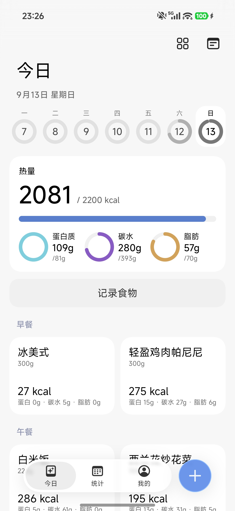
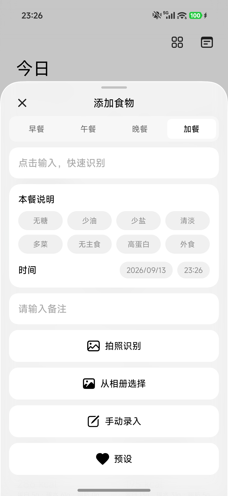
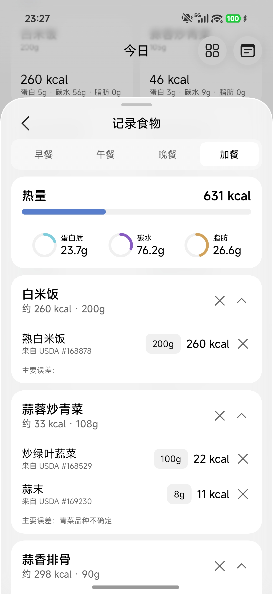
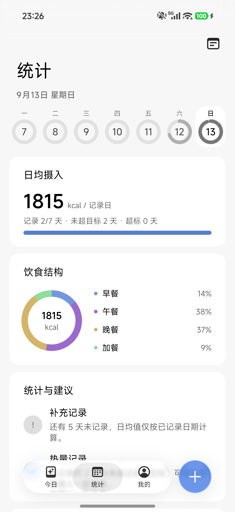

# LightMemo · 轻食记

拍照识别或手动记录一餐的热量与营养，准确拆分基础食物，数据库匹配热量与营养。

---

## 功能展示

- **MCP 服务**：设置 → AI 设置 → MCP 服务，连接小爱查询当天营养，或将饮食描述直接交给原有文字录入识别流程；识别、营养匹配、实时活动通知与结果确认全部复用现有功能。详见 [连接说明](docs/mcp-service.md)。

### 今日

- **热量总览**：当日摄入大数字 + 进度条，对照每日目标一眼可见
- **三大营养素环**：蛋白质 / 碳水 / 脂肪各自进度与目标
- **按餐次组织**：早餐、午餐、晚餐、加餐；卡片式全览

<p align="center">
  
</p>

### 记录一餐

- **多种方式任选：** 总有一种你想要的
- **智能识别对话**：在添加食物页底部进入对话，描述本人吃下的食物，由 AI 逐项提供选项确认份量，“记不清”可按常见份量估算；信息齐全后可继续补充食物或生成记录，核对结果后保存，复用当前识别 API 配置
- **识别上岛***：接入安卓16实时更新通知，支持的系统可以上岛
- **识别流程**：图片质量检查 → 菜品识别 → 组成拆解 → 二次视觉审核 → 映射标准食物 → 按重量计算
- **丰富的识别结果**：按菜品展示组成、估计重量区间、置信度与数据出处；改动即时重算
- **本地个人食物记忆**：确认保存后学习份量、组成与数据库选择；下次同名识别显示历史建议，支持使用或忽略，可在数据管理中查看和清除
- **重复识别加速**：照片仍先进行视觉识别，稳定且高置信度的个人记忆可复用组成与营养参考，减少一次模型复核；同一照片在 48 小时内再次识别时，可选择使用上次结果或重新识别

<p align="center">
  
  
</p>

### 统计

- **本地诊断**：关于页可查看最近 30 天的识别成功率、耗时、数据库匹配、用户修改与推荐统计；支持数值 JSON 导出和单独清空，统计仅保存在本机

- **日均与达标**：记录日数、日均热量、未超目标 / 超标天数
- **饮食结构**：各餐次热量占比环图
- **每日柱状图**：近一段时间逐日摄入，点选查看单日详情
- **摄入建议**：实时推荐摄入种类

<p align="center">
  
</p>


---

## 界面

整体是 HyperOS 风格的液态玻璃，这太Hyper了

| 区域 | 表现 |
|------|------|
| 底栏 | 胶囊玻璃 Tab，拖动时有阻尼拉伸与速度拉长；圆形液态玻璃按钮可按压缩放、拖拽跟手形变 |
| 顶栏 | 可折叠大标题 + 渐进模糊；右侧液态图标按钮（管理卡片、切换月视图） |
| 卡片 | Miuix `Card`，内容区统一 16dp 边距； |
| 弹层 | 毛玻璃 Bottom Sheet |
|  |


---

## 技术

### 栈

- **Kotlin** + **Jetpack Compose**（BOM 2025.10）+ **AGP 9** / JDK 21
- **UI**：本地 `miuix-glass`（`top.yukonga.miuix.kmp:*-android:0.9.4-rclocal`）
- **持久化**：Room 饮食记录与本地学习数据 + DataStore 设置（兼容迁移旧版 JSON 日志）
- **网络**：OkHttp + kotlinx.serialization
- **图像**：Coil 3
- **识别**：OpenAI 兼容 `chat/completions` Vision（菜品拆解、估重、审核）
- **营养库**：
  - USDA FoodData Central SR Legacy 离线库（约 7,793 条，确定性计算）
  - USDA Foundation 2026-04 离线库（367 条完整宏量）
  - USDA FNDDS 2021–2023 离线库（2024-10 发布，5,431 条完整宏量）
  - 中国食物成分表第 6 版离线回退（约 1,635 条完整宏量）
  - 三套 USDA 离线库联合检索，同分优先 Foundation → SR Legacy → FNDDS；另有可选 USDA 在线 API 和中国库回退
  - 原名及中英文检索词共同召回；自动匹配校验食物身份、生熟和做法，FNDDS 配方含额外油脂或配料时需明确匹配
  - 数据库页面可分别筛选三套 USDA 数据；导入来源、校验和与复现命令见 [离线营养数据库](docs/nutrition-databases.md)

### 模块结构

```
app/
├── ui/          页面、液态玻璃组件、特效（highlight / edge light / overscroll）
├── data/        FoodLog 仓库、设置、预设食物、校验
├── domain/      Nutrition / FoodLog / MealType
├── network/     Vision 客户端、USDA FDC 客户端
└── viewmodel/   Today / Stats / Add / Settings / Backup
```

### 构建

```powershell
# 需 JDK 21 + Android SDK 37，local.properties 配置 sdk.dir
.\gradlew :app:assembleDebug
.\gradlew :app:testDebugUnitTest
```

APK：`app/build/outputs/apk/debug/app-debug.apk`

依赖本机 `~/.m2` 中的 miuix 本地包。若改过 miuix 源码，在 `miuix-glass` 工程执行各模块 `publishAndroidPublicationToMavenLocal`（`-Prc=local`）。

### 应用更新

应用启动时会检查 GitHub 仓库的最新 Release。发现新版本后，用户可以在弹窗中打开 Release 页面并下载 APK；

### 使用前配置

1. 打开 App → 设置
2. 填入api key；默认使用 DeepSeek配置，也可填写其他 OpenAI 兼容服务的 Base URL、API Key 和模型名
3. 设置每日热量目标
4.  可选：USDA FDC API Key


第三方许可与数据来源见 [`docs/THIRD-PARTY-NOTICES.md`](docs/THIRD-PARTY-NOTICES.md)。
